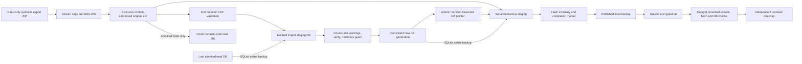

# ChatGPT archive POC Phase 2: snapshot and recovery

## 1. Executive summary

**PASS for the bounded, local evaluation lifecycle: preserve → import → verify →
backup → restore, including encrypted recovery and reconstruction from originals.**
Recommend **extend** the existing CLI with a small external archive controller,
subject to the production gates below. Reusing the application as-is still does
not provide a historical archive. No demonstrated application defect required a
source change.

The implementation and evidence are isolated to `poc/` and this report, based on
Phase 1 branch commit `3c3e93b9cdbe0f44d909b343648422a0730a88a3`. The unchanged
application remains a rebuildable current-state reader. The Phase 1 report,
11 synthetic tests, subprocess evidence and full-suite results were reviewed.
All 11 Phase 1 cases were rerun with Phase 2. No real conversation exports,
credentials, remote storage, scheduled tasks, deployment, merge or publication
were used. Fetching the requested existing Git branch was the only remote
repository operation; no push was performed.

Final combined run: **31 tests passed, 0 failed, 0 skipped**: 20 new lifecycle
cases and 11 Phase 1 cases. A separate fresh-process representative-scale run
passed. GnuPG 2.4.7 encrypted and decrypted a completed backup; the decrypted
original ZIPs, manifest and consistent database matched the source backup's
SHA-256 inventory and canonical rows. **Encrypted local recovery: VERIFIED.**
Restic was absent and was not installed. **Restic and off-server recovery: NOT
TESTED.** No encrypted remote/off-host claim follows from the local result.

## 2. Architecture and data flow

The standalone Python controller uses stdlib/SQLite and subprocesses for the
unchanged application CLI; GnuPG is an optional installed encryption utility.
`manifest.json` is a versioned snapshot catalog and sole current-view pointer.
Snapshot IDs are ZIP SHA-256 values. Records contain byte size, acquisition UTC
time, validation status/error, import order, and safe attempt outcomes, warning
codes and counts. Each attempt records interpreter/SQLite versions and the CLI
entry-file hash; the Git revision must also be retained separately.

Canonical originals are published exclusively as `objects/<sha256>.zip`, fsynced
and mode 0400. The controller never overwrites/removes them or changes user input
paths. A successful disposable staging hard link is unlinked after canonical
publication; it is not an original archive pathname. Duplicate disposable copies
are also discarded. Failed staging and old read generations remain for review.
Read-only mode is an accidental-write guard, **not WORM**: an owner/root can change
it. Trusted private local directories and a cooperating controller-only writer
policy are assumptions.

All controller operations take one Linux flock. A working DB starts with the
online backup of the selected current generation, preserving the application's
missing-whole-conversation behavior. Imports only touch staging. A warning-free,
verified, non-regressing result is consolidated with SQLite's online backup API
and fsynced under a new generation name. Atomic manifest replacement selects that
generation. A crash before replacement leaves the previous view selected; orphan
staging/generations do not become current. A crash after original publication but
before catalog registration can leave an unregistered original object; it remains
untouched and can be registered by identical resubmission. Readers open the path
in the manifest, and must reopen to see a newer generation.

## 3. Snapshot and import-ordering policy

Acquisition time never determines conversation freshness. The controller has no
merge engine or force flag.

1. Preserve every submitted ZIP's complete bytes, even malformed inputs. Validate
   every member's CRC without extraction, including binary attachments. POC bounds:
   100,000 members and 512 MiB declared expanded bytes, plus existing CLI limits.
2. Exact byte duplicates have one snapshot and no second admission. A different
   ZIP with identical canonical data remains a separate snapshot. Re-submitting
   an already admitted old snapshot does not replay it over a later head.
3. First admission requires `--after none`; subsequent admissions require the
   exact current head SHA. This avoids implicit order and stale-head mistakes.
4. Latest CLI run must finish successfully. Any warning, skipped element, safe
   post-commit warning signal, stderr diagnostic, or verification failure blocks
   publication. Successful warning-bearing imports are recorded as **partial**
   and their original ZIPs remain available. This deliberately over-classifies
   harmless warnings rather than claiming unproven completeness.
5. Compare each existing conversation's timestamp, aggregate hash, title, creation
   time, current node, flags, model, metadata and exported ID with staging. A changed
   existing state requires finite old/new update times and a strictly larger new
   time. Equal/decreasing/unknown times with changes reject the entire admission.
   Missing whole conversations remain through the copied baseline. New IDs can be
   admitted without proving a chronology for those IDs. Unchanged states pass.
6. Import orders are monotonically allocated attempt integers, with gaps after
   failure. Only successful `import_order` records enter replay. Partial/rejected
   snapshots can be inspected in a separate fresh project DB. Acquisition order,
   failed attempts and preserved-only snapshots are never replay instructions.
7. A durable `importing` record left after process death becomes `interrupted` on
   the next controller operation. Retrying cannot replace originals. Recover a
   lost read DB with `rebuild`, which replays admitted snapshots in recorded order
   and verifies a separate new DB. It does not change the live manifest pointer.

Verified guards stop the tested older and equal/unknown-time edits, including a
mixed-time ambiguity case. **Assumption:** export update times are meaningful.
Strictly increasing timestamps cannot prove every node/field truly newer, detect
an intentionally misleading timestamp, or preserve unknown fields discarded by
the reader. Originals remain the historical authority. The conservative rule can
reject legitimate title/metadata changes whose timestamps did not advance.

## 4. Tested scenarios and evidence

Primary evidence: [commands](poc/evidence/phase2/commands.json),
[combined output](poc/evidence/phase2/suite.txt),
[combined metrics](poc/evidence/phase2/suite.json),
[CLI commands/results](poc/evidence/phase2/cli-commands.json),
[partial import](poc/evidence/phase2/partial-import.json), and
[environment/tool versions](poc/evidence/phase2/environment.json).

| Scenario | Result and scope |
|---|---|
| Multiple preserved originals | PASS; three scale snapshots retained and recovered with SHA equality |
| Duplicate submission/admission | PASS; one catalog/object entry, no extra import or current-state change |
| Explicit predecessor | PASS; stale/missing correct predecessor rejected |
| Older snapshot after newer | PASS; per-conversation regression rejected; current view and originals remain |
| Equal/unknown-time edits | PASS; whole admission rejected, including title-only edit |
| Missing whole conversations | PASS; retained across subsequent controller admission |
| Partial successful CLI import | PASS; CLI exit 0, 2 skipped invalid elements, warning count 2; controller status partial/exit 2, old head remains |
| Malformed conversations JSON | PASS; isolated CLI fails, prior view remains, malformed original remains |
| Corrupt ZIP / attachment CRC | PASS; invalid ZIP bytes preserved; damaged binary member detected despite valid conversation member |
| Preserved checksum mismatch | PASS; admission and verification reject deliberate damage; unmodified other originals stay intact |
| Interrupted import/publication | PASS; real abrupt controller exit after import and before pointer publication; prior canonical view remains, retry succeeds |
| Running CLI interruption | PASS; kill owned controller/CLI process group after actual child launch; interrupted record and old selected DB survive |
| Disk full | PASS, **simulated** ENOSPC during copy, generation publication and manifest replace; no filesystem was filled |
| Interrupted backup | PASS; injected interruption leaves unpublished incomplete directory; restore refuses missing completion/hash artifacts |
| Damaged backup | PASS; modified copied ZIP fails backup inventory before restore publication |
| SQLite WAL consistency | PASS; committed test row still in live WAL survives online backup and independent restore |
| Active database loss | PASS; synthetic read DB moved out of service; original ZIP replay creates canonical-equal verified fresh DB |
| Controller serialization | PASS; second process waits while flock is held, then verifies |
| Separate destinations | PASS; nested or existing backup/restore destinations rejected |
| GnuPG encryption/decryption | PASS; decrypted inventory and canonical rows match, wrong key and flipped ciphertext rejected |
| 1,000 conversations / 5,000 nodes | PASS; branches, five 403-node conversations, multimodal structures, 4 binary attachments and 100 updated conversations |

Failures were retained: the initial 15-case run had 13 passes and 2 failures
([output](poc/evidence/phase2/first-run.txt)). The wrapper initially used only
aggregate_hash, which excludes titles and some top-level metadata; the equal-time
title test exposed that defect. The second failure was a disk-full fixture that
accidentally submitted a duplicate and bypassed the injection. The guard and
fixture were corrected; [second run](poc/evidence/phase2/second-run.txt) passed all
15 cases. Additional CLI/encryption/interruption/retention tests brought the
final lifecycle count to 20. An initial GnuPG probe failed because no agent was
running with autostart disabled; the final code explicitly starts, terminates and
reaps a private foreground agent. See [development notes](poc/evidence/phase2/development-notes.txt).
No failing application behavior was hidden or patched. The first-scale evidence
is diagnostic history, not the final measurement.

## 5. Storage and resource measurements

Source: [fresh isolated scale measurements](poc/evidence/phase2/scale.json) and
[fresh subprocess metrics](poc/evidence/phase2/scale-run.json). Linux x86_64,
Python 3.12.14, SQLite 3.53.1. Single runs on this cloud machine are not sizing or
latency promises for a small Linux server. Full new/baseline test command took
17.535 seconds (unittest 17.395); isolated scale command took 6.678 seconds
(unittest 6.558). No inherited tracemalloc in the formal isolated scale run.

The fixture has 1,000 conversations and 5,000 total mapping nodes. Five
conversations contain a 400-node extension plus the initial three-node branch
graph; the others have three nodes. Every tenth conversation includes a non-text
asset pointer. Four pseudorandom synthetic binaries are 4 MiB, 2 MiB, 1 MiB and
4 KiB (7,344,128 total bytes). Repeated canonical content is deliberately
compressible; these ZIP/DB ratios are workload-specific. The second snapshot
contains the same canonical conversations with a different ZIP member inventory;
the third advances 100 titles/timestamps and retains the other 900 conversations.

| Measurement | Observed value |
|---|---:|
| First ZIP | 7,394,174 bytes |
| All 3 stored original ZIPs | 7,489,030 bytes |
| First admitted SQLite DB, including core FTS | 13,103,104 bytes |
| Core FTS table page allocation (`dbstat`) | 3,018,752 bytes |
| Optional Web indexes | NOT TESTED / not built |
| Preserve and full ZIP CRC validation | 0.034 s |
| First CLI import / entire controller admission | 0.523 / 0.755 s |
| Canonical re-import CLI / controller | 0.467 / 0.696 s |
| 100-conversation update CLI / controller | 0.486 / 0.703 s |
| Identical ZIP submission | 0.013 s |
| Child-process high-water RSS | 57,712 KiB |
| Test harness high-water RSS | 59,888 KiB |
| Active archive logical bytes before backup | 86,256,599 bytes |
| Retained work logical bytes at that endpoint | 39,428,096 bytes |
| Completed plaintext backup | 20,614,969 bytes / 0.241 s |
| Plaintext restore + hashes + verify | 0.256 s |
| GnuPG encrypted backup | 7,939,480 bytes / 1.391 s |
| Decrypt, restore, hashes + verify | 0.435 s |
| Rebuild all 3 admitted original ZIPs + verify | 1.691 s |
| Transient temporary disk peak | NOT MEASURED; null in evidence |

RSS values are Linux per-process maxima across the workload, not simultaneous
summed process-tree RSS; child values include importer/verifier/GnuPG activity,
not an importer-only sample. End-of-stage DB/work/file sizes are not peaks. Logical
sizes count unique inodes once and do not represent allocated filesystem blocks.
The core FTS allocation includes its content and shadow tables, not just index
postings. Backups include all original snapshots and only the current read DB;
active storage additionally retains prior DB generations and work. Plaintext tar,
backup, decrypted staging and original input fixtures consume additional space
outside the active archive; their transient aggregate peak was not sampled.
No multi-GiB stress, sustained service RSS, CPU capacity, fragmentation, concurrency
throughput or production RPO/RTO was measured.

## 6. Backup and restore results

**Verified complete local workflows:**

- Plaintext consistent backup → separate directory restore → SHA inventory equal →
  SQLite `integrity_check=ok`, empty `foreign_key_check`, project `verify` exit 0 →
  canonical rows equal.
- Same completed backup → GnuPG AES256 symmetric encryption → decryption and
  bounded regular-file unpack → all the preceding restore checks → canonical rows
  equal. Wrong test passphrase and damaged ciphertext never publish a restore.
- Preserved original ZIPs → fresh DB in admitted order → SQLite/application verify
  → canonical rows equal, including the scale workload and a lost-active-DB case.

Backup serializes controller changes, verifies original hashes/sizes, copies full
original ZIPs and catalog, and uses `Connection.backup()` for the read DB. The
source may have a live WAL: the dedicated WAL test holds a writer connection with
a committed uncheckpointed row and proves it survives. No blind main-file-only
WAL copy is used. This does **not** test unrelated concurrent application writers
during backup or imply the controller supports them.

The final backup SHA inventory is retained inside scale evidence. Restore checks
inventory equality before copying, after copying and after verification, plus
each ZIP's declared hash/size. Rebuild comparisons cover conversation identity,
title, current node, aggregate hash, node identities/relationships, text and raw
messages; they are semantic equality, not SQLite-byte equality or full-export
projection fidelity. ZIP hash equality covers full attachment bytes and all
other original fields. Hashes are not authentication against an attacker able to
replace both data and inventories.

GnuPG 2.4.7/libgcrypt 1.11.0 were preinstalled. GnuPG owns the cipher, passphrase
handling and integrity mechanism; Python supplies a tar bundle and passes a
synthetic test passphrase via inherited file descriptor. Its private local agent
is supervised with bounded waits and reaped. No real keyring or credentials were
used. GnuPG symmetric recovery is verified; **restic, remote transfer, key escrow,
recovery on a separate machine and encrypted-only disk handling are NOT TESTED**.
Plaintext staging deliberately remains available for review; encrypted backup
success does not mean the active archive or staging is encrypted.

## 7. Known limitations and residual risks

- Trusted operator, manifest and local directories; no hostile-account, tamper-
  proof object store, WORM, multiuser permission audit or authenticated catalog.
  Mode 0400 and SHA-256 do not prevent a privileged owner changing bytes/manifest.
- Timestamp-based admission can reject legitimate edits and cannot prove source
  chronology. No per-node history merge or revision-query UI is implemented.
- Strict warning gate intentionally blocks benign warnings as well as skipped
  records. Original availability does not mean the reader imported every field.
- Manifest/copy/scan complexity grows linearly; no large-catalog benchmark. Full
  database copy per admission, full original copy per backup, retained generations,
  tar/decrypt staging and no retention policy increase storage and manual effort.
- Failed/interrupted work and orphan originals/DB generations need reviewed manual
  reconciliation. No automatic deletion, pruning, cleanup or active-DB promotion.
  A killed controller can leave a CLI child working only on unpublished staging;
  process supervision outside this POC remains an operational responsibility.
- Local flock, hard links, rename and fsync are assumed to work correctly. Actual
  power loss, filesystem/hardware failure, directory-fsync failure after replace,
  NFS semantics and complete-disk exhaustion were not tested. A post-replace fsync
  failure can report an error despite a newly selected generation/directory.
- Replay requires pinned compatible code/SQLite/FTS capabilities. The bundle does
  not contain application code; entry-file hashes are not a full dependency lock.
  No schema-upgrade/rollback drill or automatic version mismatch gate.
- Backup keys have no managed recovery/rotation/escrow procedure. Private plaintext
  staging is a confidentiality risk until an operator applies a reviewed lifecycle.
  GnuPG package maintenance is additional operational work; restic's incremental
  storage and repository operations remain unevaluated.
- Controller/unwrap limits are deliberate POC bounds (ZIP 512 MiB expanded;
  decrypted tar regular files 1 GiB total and 100,000 members). GnuPG decryption
  itself occurs before tar limits; encrypted input size/decompression disk admission
  is not hardened against hostile bundles. Only trusted generated backups qualify.
- Windows, remote/cloud storage, scheduled backups, application UI/index behavior,
  production loads, physical media failure, second-host and disaster recovery are
  NOT TESTED here. Phase 1's full existing suite results are historical evidence;
  only its 11 POC cases were rerun in Phase 2.

## 8. Estimated operational complexity

A small local workflow needs one Python command set, filesystem ownership/storage,
a retained application revision and optional GnuPG. There is no daemon, container,
API or database server to operate. Per export: preserve, inspect status, admit
against the exact head, verify, create a separate backup, encrypt if desired and
perform a periodic independent restore/rebuild drill. Warning rejections require
human review; readers must reopen the newly selected generation.

Estimated staffing effort is qualitative, not measured: low for an occasional
manual local synthetic POC; moderate for a private-server service once key custody,
off-host copies, monitoring, capacity alerts, retention, upgrades and recovery
ownership are added. No defensible production time/cost estimate or RPO/RTO is
available from these single runs. Avoid turning this POC into a backup scheduler.

## 9. Recommendation

**Extend** with a small external preservation/admission/backup boundary and retain
the existing CLI as a derived reader. This evaluation supports that architecture;
it does not support deploying this POC unchanged. Reuse as-is lacks original
snapshot cataloging, deterministic admission and complete backup orchestration.
Building a new parser/reader would add maintenance without solving key custody,
backup independence or timestamp ambiguity. Reconsider a minimal alternative only
if native per-snapshot revision queries become a firm product requirement.

## 10. Remaining acceptance criteria before production

1. Set RPO/RTO, expected conversation/media volume, retention and ownership; repeat
   capacity/RSS/disk-peak tests on the intended small Linux server.
2. Verify an encrypted off-server restore on a separate machine using independently
   recoverable keys; simulate loss of the server and its local credentials/code.
3. Choose and evaluate a maintained backup utility/strategy (prefer restic where
   available), incremental storage, retention and restoration of older generations.
4. Define warning review and ambiguous-timestamp admission decisions using suitable
   representative exports under an explicitly authorized private-data procedure.
5. Harden manifest/version validation, code pinning, permissions, encryption staging,
   disk admission, supervision and exact orphan reconciliation before automation.
6. Prove crash/power-loss/disk-full behavior and recoverable publication on the target
   filesystem; add storage monitoring and a reviewed manual recovery/promotion runbook.
7. Test schema/application upgrades against independently verified external backups;
   schedule only after a reviewed backup/restore process has clear ownership.

The eight requested POC success criteria are **PASS within this local synthetic
scope**: original snapshot retention, idempotence, deterministic admission,
explicit partial/corrupt handling, consistent backup restore, original replay,
complete backup/restore workflow, and representative resource observations.
**FAIL:** none in the final suite. Earlier development failures remain visible.
**NOT TESTED:** production/off-server durability, restic, physical ENOSPC/power-loss,
remote services, multi-GiB workloads, and transient disk peaks. No production
readiness or deployment approval is implied.
